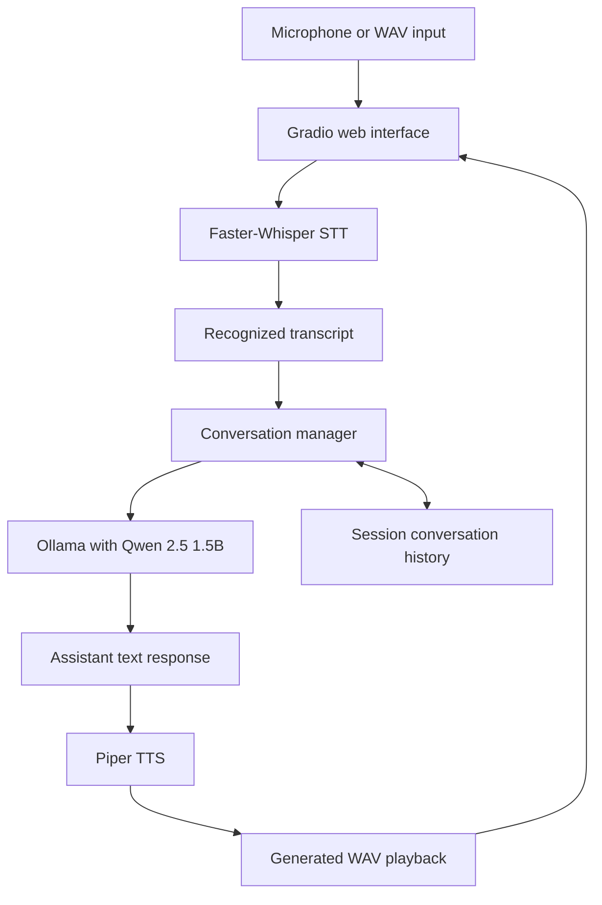

# Local Voice AI Assistant

An end-to-end local voice assistant developed for the **Trikon Software Labs LLP — Voice AI Assistant Assignment**.

The application listens to spoken input, transcribes it locally, generates a conversational response with an open-weight language model, and speaks the response aloud. The complete pipeline runs locally with modular services for speech recognition, language generation, and speech synthesis.

## Features

- Microphone recording and WAV upload through Gradio
- Speech-to-text with Faster-Whisper
- Local response generation with Qwen 2.5 through Ollama
- Local text-to-speech with Piper
- Conversation history across multiple turns in a Gradio session
- Per-turn STT, LLM, TTS, and total latency measurements
- Separate **Clear audio** and **Clear conversation** controls
- Validation and visible error messages for missing or invalid input
- No paid or hosted AI inference APIs

## Architecture



### Processing flow

1. The user records speech or uploads a WAV file.
2. Faster-Whisper converts the audio into text.
3. The transcript and conversation context are sent to the local Ollama API.
4. Qwen generates an assistant response.
5. Piper converts the response text into a WAV file.
6. Gradio displays the transcript and response and plays the generated audio.

See [`docs/architecture.md`](docs/architecture.md) for the detailed architecture and data flow.

## Technology stack

| Component | Technology |
| --- | --- |
| Programming language | Python |
| Web interface | Gradio 6.30.0 |
| Speech-to-text | Faster-Whisper 1.2.1 |
| STT model | Faster-Whisper `tiny`, CPU, INT8 |
| Language model runtime | Ollama |
| Language model | Qwen `qwen2.5:1.5b` |
| Text-to-speech | Piper |
| Piper voice | `en_US-lessac-medium` |
| Audio processing | Local audio files and microphone input |

## Project structure

```text
trikon-voice-assistant/
├── app.py                    # Gradio web application
├── voice_assistant.py        # End-to-end pipeline orchestration
├── stt_service.py            # Faster-Whisper speech recognition
├── llm_service.py            # Ollama/Qwen response generation
├── tts_service.py            # Piper speech synthesis
├── test_llm.py               # LLM component test
├── test_stt.py               # STT component test
├── test_tts.py               # TTS component test
├── test_voice_assistant.py   # Integrated pipeline test
├── requirements.txt
├── docs/
│   └── architecture.md
└── outputs/                  # Generated audio; not committed
```

## Prerequisites

- Windows 11
- Python 3.10 or a compatible version supported by the dependencies
- Ollama installed and running locally
- Ollama model `qwen2.5:1.5b`
- Piper executable and a compatible voice model
- A microphone and speakers or headphones for microphone testing
- Git, if cloning the project

The first Faster-Whisper run may download the selected model into the local Hugging Face cache. Network access may therefore be required during initial setup. Inference itself uses local models and services.

## Windows setup

### 1. Clone the repository

```powershell
git clone https://github.com/YOUR_GITHUB_USERNAME/trikon-voice-assistant.git
cd trikon-voice-assistant
```

Replace `YOUR_GITHUB_USERNAME` with the repository owner's GitHub username.

### 2. Create and activate a virtual environment

```powershell
python -m venv .venv
.\.venv\Scripts\Activate.ps1
```

If PowerShell blocks activation, use the project interpreter directly:

```powershell
.\.venv\Scripts\python.exe -m pip install --upgrade pip
```

### 3. Install Python dependencies

```powershell
.\.venv\Scripts\python.exe -m pip install --upgrade pip
.\.venv\Scripts\python.exe -m pip install -r requirements.txt
```

Do not commit `.venv`, model weights, or generated audio files.

### 4. Set up Ollama

Install Ollama using its official Windows installer, start the Ollama service, and download the configured model:

```powershell
ollama pull qwen2.5:1.5b
ollama list
```

The application calls Ollama's local API at:

```text
http://localhost:11434/api/generate
```

Keep Ollama running while using the assistant.

### 5. Set up Piper

The current setup expects the following assets one directory above the project:

```text
D:\voice-assistant\
├── models\piper\en_US-lessac-medium.onnx
├── models\piper\en_US-lessac-medium.onnx.json
└── tools\piper\piper\piper.exe
```

The configured voice is `en_US-lessac-medium`:

| Property | Value |
| --- | --- |
| Language | English (United States) |
| Dataset/voice | Lessac |
| Quality | Medium |
| Sample rate | 22050 Hz |
| Speakers | 1 |

`tts_service.py` resolves these paths relative to the project directory. If the assets are stored elsewhere, configure them with:

```powershell
$env:PIPER_EXECUTABLE = "C:\path\to\piper.exe"
$env:PIPER_MODEL = "C:\path\to\voice.onnx"
```

The matching `.onnx.json` file must remain beside the voice model.

## Run the application

From the project root:

```powershell
.\.venv\Scripts\python.exe app.py
```

Open the local URL printed by Gradio, normally:

```text
http://127.0.0.1:7860
```

Allow microphone access when the browser requests permission. You can also upload a WAV file instead of recording through the microphone.

## Testing

### Component tests

Run the independent checks with the project interpreter:

```powershell
.\.venv\Scripts\python.exe test_llm.py
.\.venv\Scripts\python.exe test_stt.py ..\outputs\test.wav
.\.venv\Scripts\python.exe test_tts.py
```

Run the integrated STT → LLM → TTS pipeline:

```powershell
.\.venv\Scripts\python.exe test_voice_assistant.py ..\outputs\test.wav
```

The integration test prints the transcript, assistant response, generated WAV path, and stage latencies.

### Microphone recording

1. Start the application and open its local Gradio URL.
2. Allow microphone access.
3. Click the audio component's **Record** control.
4. Speak for two or three seconds.
5. Click **Stop** and wait for the waveform to remain visible.
6. Click **Process**.
7. Confirm that the transcript, assistant response, generated WAV, and latency values appear.

### WAV upload

1. Choose the upload option in the audio component.
2. Select a known-good WAV file, such as `..\outputs\test.wav` when available.
3. Wait for the audio preview to appear.
4. Click **Process** and verify the same outputs.

### Generated speech

Play the response audio in the Gradio interface. The standalone TTS test also writes a generated WAV under `outputs`.

### Two-turn conversation memory

1. Process a first question, such as: `What is artificial intelligence?`
2. Process a related follow-up, such as: `Explain it in simpler words.`
3. Confirm that both turns appear in the conversation history.
4. Confirm that the second response can use context from the first turn.
5. Click **Clear conversation** to reset the session history. Use **Clear audio** when only the current recording should be removed.

## Latency measurements

The following values are from an earlier integrated run on the development machine. They are illustrative measurements, not standardized benchmarks or guarantees:

| Pipeline stage | Earlier observed latency |
| --- | ---: |
| Speech-to-text | 1.28 s |
| LLM response generation | 10.04 s |
| Text-to-speech | 1.22 s |
| **Total pipeline** | **12.54 s** |

**Test environment:** Windows 11 laptop, Intel Core i5-1240P, 8 GB RAM, Qwen 2.5 1.5B through Ollama, Faster-Whisper, and Piper.

Actual performance varies with CPU speed, model warm-up, prompt length, audio duration, response length, and system load. LLM latency can vary significantly between runs.

## Troubleshooting

### Ollama is unavailable

Make sure Ollama is running and the model is installed:

```powershell
ollama list
```

The application reports connection and timeout errors in the interface and prints unexpected exception tracebacks in the terminal.

### No audio was received

Make sure recording has stopped and the waveform remains visible before clicking **Process**. For a controlled test, upload a known-good WAV file. The application logs the received input type, sample rate when available, and duration without printing audio contents.

### Piper files are not found

Verify that `piper.exe`, the `.onnx` model, and its matching `.onnx.json` file exist. If the files are in another location, set `PIPER_EXECUTABLE` and `PIPER_MODEL` as shown in the Piper setup section.

### Microphone permissions

Check the browser's microphone permission for the local Gradio page. If the audio component remains in an unexpected state after a code change, stop old Gradio processes and open the newly printed URL in a fresh browser tab.

### First-run model loading

The first Faster-Whisper run may download and load model files. Later runs use the local cache. The application keeps the Whisper model loaded for the Gradio process rather than loading it for every turn.

## Privacy and local execution

The core inference components run locally:

- Faster-Whisper processes speech through the local STT service.
- Ollama receives prompts through its local HTTP API.
- Piper synthesizes speech using local executable and model assets.

Network access may still be required for initial installation and model downloads. Privacy also depends on the actual machine configuration and any other services enabled.

## Current limitations

- Sequential STT, LLM, and TTS processing produces cumulative latency.
- Recognition accuracy varies with accents, background noise, and proper names.
- Performance is constrained by available CPU and memory.
- Model and voice assets require separate setup.
- Streaming, voice activity detection, and interruption handling are not implemented in the current basic interface.

## Future improvements

- Streaming speech recognition and incremental response generation
- Voice activity detection and interruption handling
- Better recognition of proper names and multilingual speech
- Configurable voice selection and language settings
- Response-length and model-performance optimization
- Broader automated test coverage and repeatable benchmark collection

## Assignment

**Organization:** Trikon Software Labs LLP  
**Project:** End-to-End Voice AI Assistant Using Open-Weight Models

This project demonstrates the integration of local speech recognition, an open-weight conversational language model, local speech synthesis, conversational memory, latency measurement, and a browser-based interface into one complete voice-assistant pipeline.
