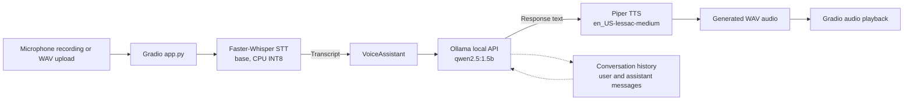

# Architecture

## Data flow

1. The user records from the microphone or uploads an audio file in Gradio.
2. `app.py` normalizes the Gradio filepath or NumPy audio tuple to a WAV path.
3. `stt_service.py` transcribes the WAV with Faster-Whisper `base` using CPU INT8, automatic language detection, beam search, and VAD filtering.
4. `llm_service.py` sends the transcript and prior conversation context to the local Ollama API with streaming enabled.
5. Ollama yields response chunks, which Gradio progressively displays as accumulated response text.
6. After the stream completes, the final user/assistant pair is stored in conversation history.
7. `tts_service.py` sends the complete response text to the local Piper executable.
8. Piper writes a WAV response, which Gradio makes available for playback.
9. STT, LLM, TTS, and total processing latencies are returned for the turn.

All core inference runs locally. No paid or hosted inference API is required.
